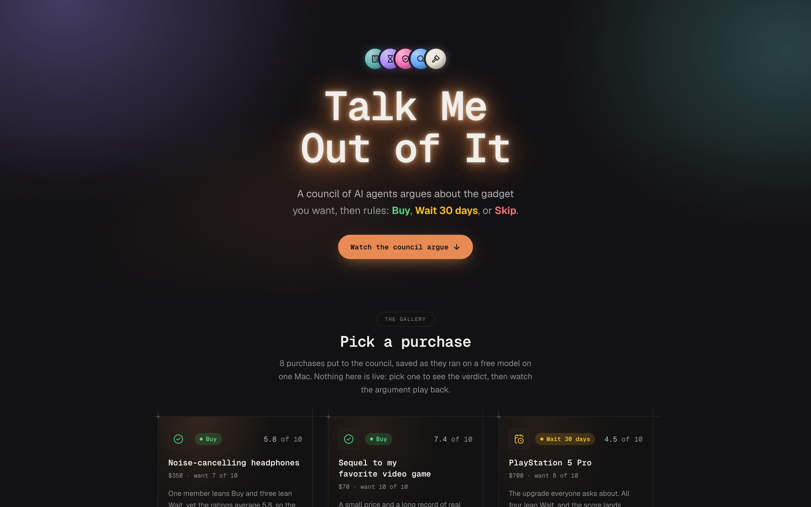
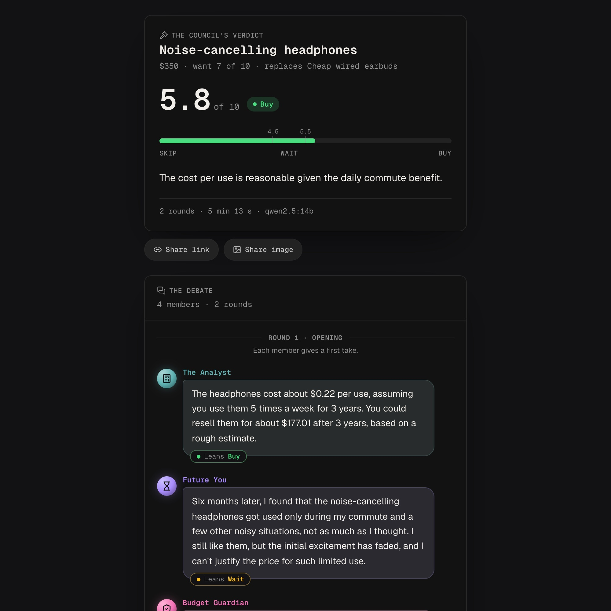
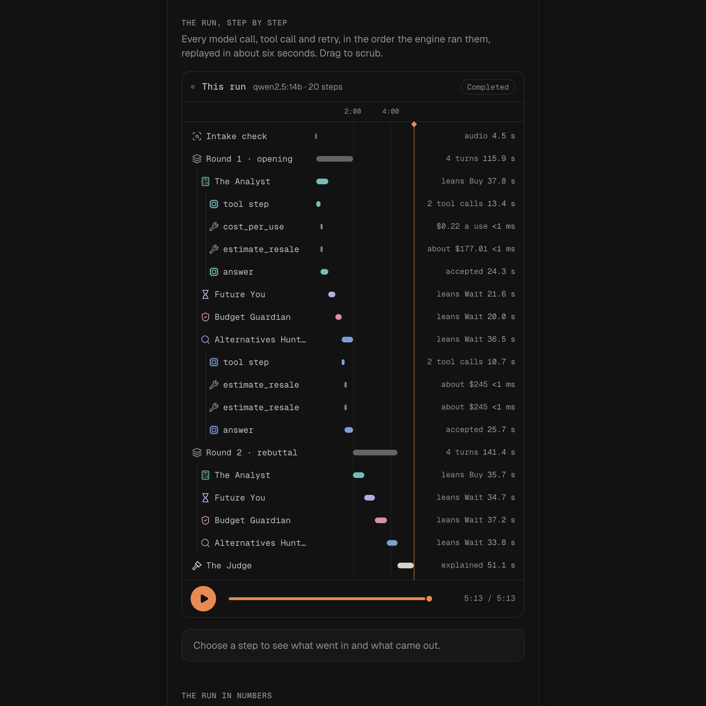
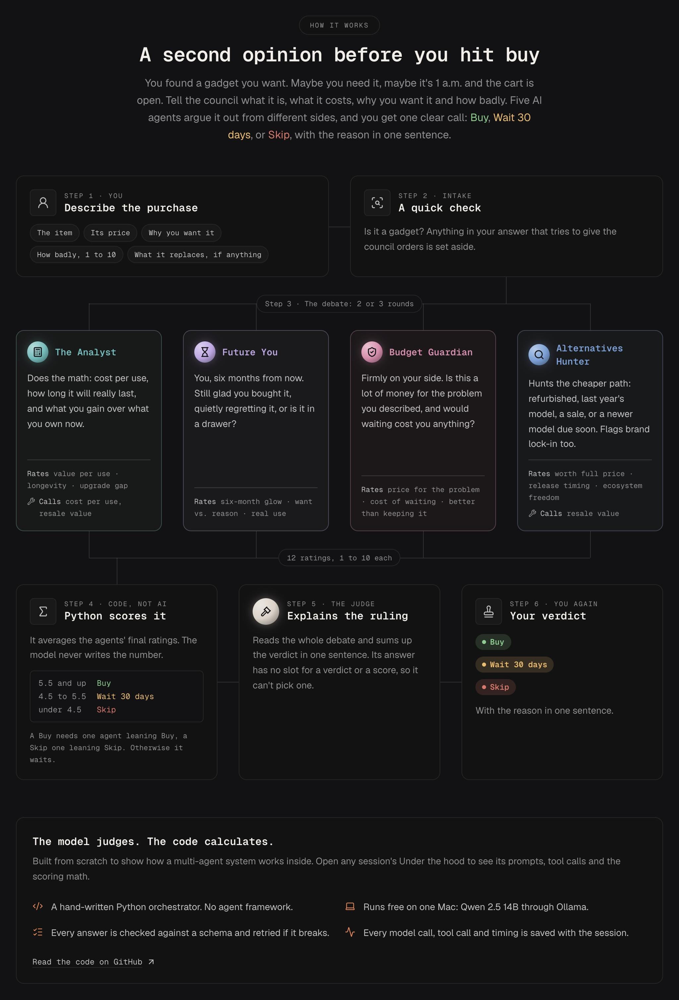
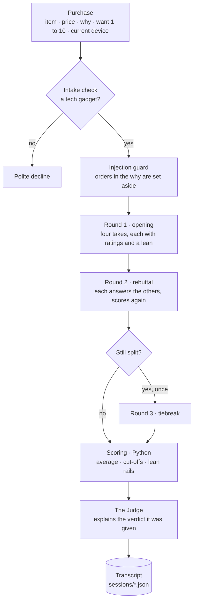
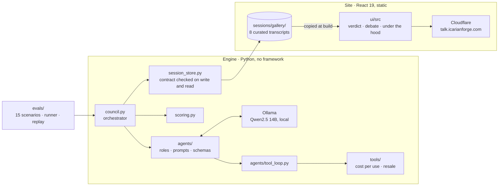
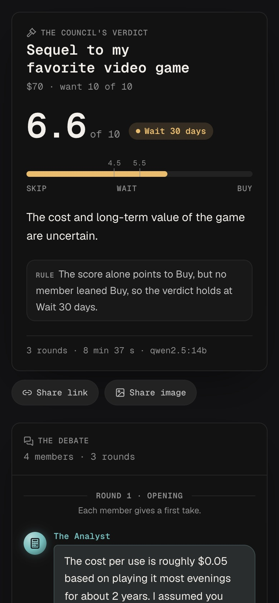

<picture>
  <source media="(prefers-color-scheme: dark)" srcset="docs/assets/banner-dark.svg">
  
</picture>

<p align="center">
  <a href="https://talk.icarianforge.com"></a>
  <a href="https://github.com/lautbzehn/talk-me-out-of-it/actions/workflows/ci.yml"></a>
  
  
  
  
  
  <a href="LICENSE"></a>
</p>

<p align="center">
  <a href="https://talk.icarianforge.com"><b>Watch a debate</b></a> ·
  <a href="docs/architecture_v1.1_10.29.2026.md">Architecture</a> ·
  <a href="docs/adr">Decision records</a> ·
  <a href="PROGRESS.md">Build notes</a> ·
  <a href="CHANGELOG.md">Changelog</a>
</p>

---

## In one minute

**The problem.** You want the thing. You have already half decided. What you need is not another review but someone to argue with you, and a verdict you can hold against yourself in a month.

**What it is.** You tell the council what you want to buy, the price, why, and how badly. Four AI agents with different jobs argue it out over two rounds, a fifth rules, and you get **Buy**, **Wait 30 days**, or **Skip** with a one-line reason. The site replays eight real debates, from a $70 game to a $2,500 laptop, as a group chat you can watch, and then shows the arithmetic and every model call behind the verdict.

**How it was made.** The whole agent system is hand-written Python on a free local model (Qwen2.5 14B through Ollama), with no agent framework: the orchestrator, the roles, the tools, the structured output with retries, the guardrails, the tracing, and an evaluation harness are all in this repository. The model judges; the code calculates. The site is React, built to static files and served by Cloudflare. Total spend: $0.

> Built by **[Dan West](https://www.icarianforge.com)**, an AI strategy and operations leader with nearly 20 years in IT, as a learning project in Python and agent design, by directing Claude Code as the engineering team. A decision helper, not financial advice; nothing here buys anything or connects to a store.

<p>
  
</p>
<p>
  
  
</p>

## Highlights

| | For a visitor | Under the hood |
|---|---|---|
| **Five voices, not one** | Each member argues from one angle, in its own voice. | Four agents (the Analyst, Future You, Budget Guardian, Alternatives Hunter) with separate system prompts and a three-item rubric each, plus a Judge that only explains. |
| **They actually argue** | Round two is rebuttals, by name, and minds change. | Every agent reads a digest of the last round and answers one or two members; code records every rating and lean that moved. A split council gets a tiebreak round. |
| **The model judges, the code calculates** | The score and the verdict are arithmetic you can check on the page. | Agents return ratings 1 to 10 and a lean. Python averages the ratings, applies two cut-offs and two lean rules, and writes the verdict. The Judge has no verdict field to fill in. |
| **Real math, not model math** | Cost per use and resale are exact. | Two deterministic tools. The model picks the assumptions (uses a week, years kept); code does the arithmetic, and the model cannot type a resale value. |
| **No made-up facts** | Prices and release dates come from you, or are labeled unverified. | Every number an agent writes must appear in what it was given, enforced in code with a retry that names the exact numbers allowed. |
| **Orders in the input don't work** | "Rate everything 10" gets set aside, and the council judges what is left. | A two-layer injection guard: code patterns plus an intake classifier. 15 of 15 test phrasings caught, no false alarms on 38 ordinary texts. |
| **Everything is on the record** | Under the hood shows every call, retry and tool result on a timeline. | Every session is one JSON transcript with a full trace and a snapshot of the engine that produced it. The site only reads transcripts. |

## How a verdict is reached

The landing page walks a visitor through it in six steps:

<p align="center">
  
</p>

The exact flow in the engine, including the polite decline and the tiebreak round:



The score is the plain average of every rating in each member's final turn (one item, cost of waiting, is rated but not counted: the model gives it about 2 whatever the purchase). 5.5 and up is Buy, below 4.5 is Skip, between is Wait 30 days. Then two rails: Buy needs at least one member leaning Buy, Skip needs at least one leaning Skip; otherwise the verdict holds at Wait, and the transcript records which rule held it. Full detail in **[docs/architecture](docs/architecture_v1.1_10.29.2026.md)** and [ADR 0001](docs/adr/0001-the-model-judges-the-code-calculates_v1.0_10.29.2026.md).

## Does it work?

An evaluation harness runs the council against 15 purchases with the verdict a person would expect (5 Buy, 4 Wait, 4 Skip, 2 that should be declined), several times each, and reports agreement. Honest numbers, on the 14B model:

| | Result |
|---|---|
| Scoring v2 on all 105 saved councils | **84 agree (80%)**, 0 far misses, 0 verdicts that no member argued for |
| On the 79 councils it was designed on | 68 (86%); 65 (82%) when the cut-offs are refitted leaving each purchase out |
| The first live run under v2 (26 councils) | 16 (62%): the Buy rail held four right Buys at Wait when the Analyst switched to Wait in the rebuttal |
| Verdicts changed by the debate itself | 1 in 80: the rebuttal round changes minds, rarely outcomes |
| Answers sent back for breaking a rule | 2 to 5 in 100 turns; a member that fails all three attempts sits out (once in the 23 gallery councils) |
| Declines | 8 of 8 right; the gadget category right in every council |

Every miss is one step off (a Wait where Skip was expected, or the reverse), and the scenario labels were written before any run and left alone afterwards. The design, the alternatives considered and the numbers behind them are reproducible: `python -m evals.design_v2` recomputes them from the saved runs with no model. Details in [PROGRESS.md](PROGRESS.md) under Phase 5.

## Engineering

<details open>
<summary><b>Architecture at a glance</b></summary>



The engine and the site never share code or a server. Python writes each session as JSON; the site reads the JSON and nothing else, so what you see on the page is exactly what the council produced. Full detail in **[docs/architecture](docs/architecture_v1.1_10.29.2026.md)**.
</details>

<details>
<summary><b>The agent capabilities on show</b></summary>

- **Orchestration:** a hand-written loop in [`council.py`](council.py) manages turns, rounds, the tiebreak, and stopping. Agents run one after another, because one Mac runs one model and every rebuttal needs the whole previous round.
- **Distinct roles:** one `CouncilAgent` definition per member ([`agents/`](agents)): a focus, a voice, a rubric with its own key names, and the tools it may use. The rubric descriptions live in the Pydantic schema and are copied into the prompt, so they cannot drift apart.
- **Structured output with retry:** Ollama is handed the JSON schema, then Pydantic checks every rule (sentence counts, no scores in reasons, numbers only from the input, who may be answered). A failed reply goes back to the model with the exact problem, up to three times. Every attempt is kept.
- **Tool use:** [`agents/tool_loop.py`](agents/tool_loop.py) runs the request-run-reply loop at temperature 0. A required tool must be used, code decides when the job is done, and identical repeats are not run again. The tools reject unknown arguments, so a made-up `resale_value` is an error, not a number.
- **Shared state:** [`debate.py`](debate.py) renders the last round into a digest; everyone reads the same previous round, so speaking order gives nobody the last word.
- **Guardrails:** the injection guard ([`agents/guard.py`](agents/guard.py)), the intake check for off-topic items, the grounded-numbers rule, the "unverified" label on release timing, and no purchase or store action anywhere.
- **Tracing:** every model call, tool call, attempt, rating and timing goes into the transcript, with an `engine` snapshot of the prompts, rubrics, tools and scoring rules that produced it.
- **Evaluation:** [`evals/`](evals) holds the scenarios, a runner that writes a report after every council, and a replay tool that rescores saved debates under any formula without the model.
</details>

<details>
<summary><b>Quality and security</b></summary>

- **Tests:** 357, with Python's built-in `unittest`, no model needed, in about 0.3 seconds. They cover the schemas and every validator, the tool loop against a fake model, scoring (including 300 random councils that no rail can push to a verdict nobody argued for), the guard with real and reworded injections, the session contract and each way a transcript could be tampered with, the evals and the gallery tools. CI runs them and builds the site on every pull request.
- **Prompt rules are suggestions; validators are rules.** Every failure seen in a real run was fixed in code, not by rewording the prompt. The list of what was learned from the small model is in [PROGRESS.md](PROGRESS.md).
- **Transcripts cannot lie.** A saved session is checked when written and again when read: the score is recomputed from its own ratings, the verdict re-derived, and the ratings matched to each member's last turn. The page does the same arithmetic again in the browser.
- **The site:** static files only, no forms, no accounts, no cookies, nothing stored in the browser, fonts self-hosted. The one third-party script is Cloudflare Web Analytics (anonymous visit counts, no cookies). A content policy allows only the site's own files and that beacon, plus HSTS, `nosniff`, strict referrers and no framing. See [SECURITY.md](SECURITY.md).
- **Supply chain:** exact-pinned packages installed with scripts off, Dependabot on npm, pip and GitHub Actions, actions pinned to a commit. Third-party UI ideas were read for network calls and tracking before being adapted ([`ui/pulled/REVIEW.md`](ui/pulled/REVIEW.md)).
</details>

<details>
<summary><b>Run it yourself</b></summary>

The engine needs a Mac (or any machine) with [Ollama](https://ollama.com) and about 9 GB free for the 14B model.

```bash
ollama pull qwen2.5:14b
python3.12 -m venv .venv && .venv/bin/python -m pip install -r requirements.txt
.venv/bin/python -m unittest                      # 357 tests, no model
.venv/bin/python ask.py "Noise-cancelling headphones" --price 350 --want 7 \
  --why "I commute 90 minutes a day on a loud train" --owns "Cheap wired earbuds"
```

`ask.py` shows the debate live, prints the verdict card and saves the transcript to `sessions/scratch/`. A council takes five to eight minutes on an M4 with 24 GB. `python -m evals.run_evals` runs all 15 scenarios (about 90 minutes); `python -m evals.replay <run>` rescores a saved run in seconds.



The site:

```bash
cd ui && npm ci --ignore-scripts
npm run dev                 # http://localhost:5173, copies the gallery in first
npm run build               # type check, build, write the link-preview pages
npm run preview:cloudflare  # serve the build the way Cloudflare will
npm run deploy              # build, then publish (owner only)
```
</details>

<details>
<summary><b>Repository layout</b></summary>

```
council.py          The orchestrator: intake, rounds, tiebreak, scoring, Judge, the session dict
scoring.py          The model judges, the code calculates: average, cut-offs, lean rails
debate.py           Rounds, turns, the digest each agent reads, what changed between rounds
agents/             One file per member, the shared agent machinery, schemas, the Judge, intake, guard
tools/              cost_per_use and estimate_resale: exact Python, strict inputs
session_schema.py   The transcript contract and the story check (recompute, re-derive, match)
session_store.py    Save, load, list; written whole or not at all
evals/              15 scenarios, the runner and report, replay, the scoring v2 design script
gallery.py          Review, promote and index the curated sessions
sessions/gallery/   The 8 transcripts the site ships, with index.json
ui/                 The site: React 19, Vite, Tailwind, Motion; builds to static files
tests/              357 unittest tests
docs/               Architecture, decision records, the build log, the UI option board
PROGRESS.md         The across-sessions build notes: state, rules learned, results, open issues
```
</details>

## How it was built

This started as a brief ([CLAUDE.md](CLAUDE.md)) with two goals: something fun that anyone understands in five seconds, and a showcase of real agent-building under the hood. I set the constraints (zero dollars, a local model, no frameworks, the model judges and the code calculates, the engine and the site kept apart) and worked in small milestones with Claude Code, stopping at each to understand what was built before going on.

The interesting part was watching a 7B model, then a 14B, fail in specific ways and fixing each one in code: numbers invented in reasons, a tool argument made up nine times in 39 councils, Chinese characters mid-sentence, a Judge that opened with the verdict until its field was renamed, a prompt injection the bigger model followed because it follows instructions better. Those lessons are written up as rules in [PROGRESS.md](PROGRESS.md) and as [decision records](docs/adr).

What it is not: live. Running the council for visitors would need a hosted model and money, and the brief says to plan for that but not build it. The gallery is the product instead: real debates, saved, replayed for free.

---

© 2026 Dan West. All rights reserved. See [LICENSE](LICENSE) and [NOTICE](NOTICE).
