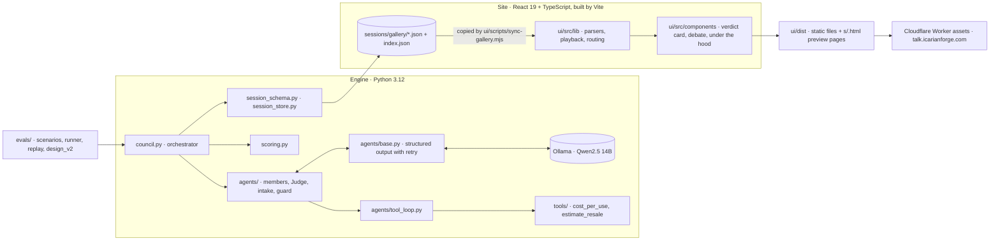
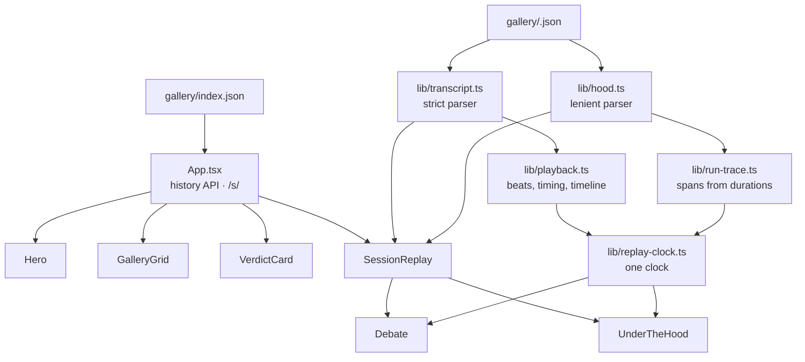

# Architecture

**v1.2 · 10.29.2026** · Talk Me Out of It, site v0.7

## Goals and constraints

| Goal | Consequence for the design |
|---|---|
| Fun and instantly understandable | One input (a purchase), one output (Buy, Wait 30 days, or Skip with a reason), and a debate you can watch like a group chat. |
| A showcase of agent building, not a wrapper around one prompt | No agent framework. The orchestrator, roles, tool loop, structured output, guardrails, tracing and evals are written here, each small enough to read. |
| $0 to build and run | A local model through Ollama; a static site with no server code. There is no live mode: visitors replay saved debates. |
| The model judges, the code calculates | Agents return ratings and a lean. Python computes the score and the verdict; the Judge explains and has no verdict field. |
| Nothing the model says is taken on faith | Every rule that matters is a validator with a retry, not a sentence in a prompt. Every number an agent writes must come from its input. |
| The engine and the site stay apart | The engine writes one JSON transcript per session; the site reads transcripts and nothing else. |

## System overview

Two programs, one file format between them. Nothing in `ui/` imports Python and nothing in the engine knows the site exists.

## The engine

### A council run

`run_council(purchase)` in `council.py` is the whole loop, in order:

1. **Validate and classify.** Pydantic checks the purchase. The intake check (`agents/intake.py`, one small model call) answers whether it is a tech gadget, which category, and whether the "why" gives the council instructions. Not a gadget: a polite `declined` session, written by code around the user's own item name.
2. **Guard.** `agents/guard.py` sets aside instructions hidden in the "why": sentences matching a short list of patterns are removed, and if only the intake flagged it, the whole "why" is replaced by a note from code. The agents only ever read the guarded purchase; the session keeps what the user typed and what was removed.
3. **Round 1, opening.** Each member gives its take in speaking order, without seeing the others.
4. **Round 2, rebuttal.** Each member reads a digest of round 1 (`debate.py`), answers one or two members by name, and scores its rubric again. Everyone reads the same previous round, never the earlier speakers of this round, so speaking order gives nobody the last word. Code records every rating and lean that changed.
5. **Tiebreak.** While no lean is held by at least three members and the round cap (3) allows, one more rebuttal round, with a note that the council is split.
6. **Scoring.** `scoring.py` turns each member's final ratings into a score and a verdict. Deterministic; the same ratings always give the same result.
7. **The Judge.** Reads the debate and the verdict and writes a summary, the strongest point each way, what would change the verdict, and a one-line reason. If its answer fails every check, code writes a template ruling.
8. **The session dict,** saved as JSON by `session_store.save_session` after `session_schema.check_session` passes.

Members run one after another. The Mac runs one model, and each round needs the whole previous round. A member whose every attempt is rejected gets a `failed` turn and sits out the rest; the council goes on while at least two members are answering.

### A member's turn

A member is a `CouncilAgent` (`agents/council_agent.py`): a name, a focus, a voice, a three-item rubric, and the tools it may call. The four members and their rubrics (10 favors buying, 1 argues against):

| Member | Rubric | Tools |
|---|---|---|
| The Analyst | value per use, longevity, upgrade gap | `cost_per_use` required, `estimate_resale` optional |
| Future You | six-month glow, want versus reason, use reality | none |
| Budget Guardian | price for the problem, cost of waiting (rated, not counted), better than keeping it | none |
| Alternatives Hunter | worth full price, release timing, ecosystem freedom | `estimate_resale` required |

Every turn runs through `open_turn` (round 1) or `rebuttal_turn` (later rounds):

1. **Gather** (`agents/tool_loop.py`), only for members with tools. The model is shown the conversation and a menu of tools and asked to send only tool calls. Code runs the requested Python function and appends the result; the loop repeats until every required tool has succeeded, the model stops asking, it repeats itself, or a step cap is hit. Runs at temperature 0, so a prompt change is an exact before-and-after.
2. **Answer** (`agents/base.py`). Ollama is handed the JSON schema of the reply (`format`), so the model can only produce text of that shape; then Pydantic validates every rule. A rejected reply goes back to the model with the exact problem ("ratings.worth_full_price.reason: write only in English; this text has Chinese characters in it") up to three times. Every attempt, with its tokens and timing, is kept.

The rubric descriptions live in the Pydantic schema and are copied into the system prompt, so the prompt and the validator can never disagree. The whole turn is recorded in a trace dict: model calls, tool calls, attempts, and why the tool phase stopped.

### The rules code enforces

Prompt instructions are suggestions; validators are rules. Each of these is a Pydantic validator with a retry message, and each exists because a model broke it in a real run:

- Short sentences: "2 or 3 short sentences, each ending with a period", counted.
- No score inside a reason, and no want level written out of 10.
- **Grounded numbers:** every number in a take, reason or response must appear in the purchase, the member's own tool results, or the debate so far; rounding a known number is fine. The retry names the closest allowed number.
- A rebuttal names one or two members it is answering, from a fixed list, and never itself.
- Release timing claims carry "Unverified:", which code prepends.
- Viewer text may not contain Chinese, Japanese or Korean characters, and may not stop at its length limit mid-sentence.
- The Judge's one-line reason may not open with the verdict word, and every number it writes must appear in the debate.

### Tools

Two pure functions in `tools/`, registered in `tools/registry.py`, which also turns their Pydantic input models into the specs the model sees:

- `cost_per_use(price, uses_per_week, years, category)`: net cost after an estimated resale value, spread over the uses. The model estimates the assumptions; code does the arithmetic.
- `estimate_resale(price, category, years_owned)`: a category lookup, labeled rough and unverified.

Inputs forbid unknown fields, so a made-up argument such as `resale_value` is an error with the real fields named, not a number the model typed. Tool results carry a `summary` sentence the model can quote, which is how exact figures reach the debate.

### Scoring

`scoring.py`, version 2, calibrated to Qwen2.5 14B:

1. The score is the plain average of every rating in each member's final turn. `cost_of_waiting` has weight 0: the 14B rates it about 2 whatever the purchase, so it carries no signal. It is still rated and shown.
2. 5.5 and up is Buy, below 4.5 is Skip, between is Wait 30 days. Rounding is half-up to one decimal before the verdict is picked, so the number on the card always matches its own verdict.
3. Two lean rails: Buy needs at least one member leaning Buy, Skip needs at least one leaning Skip; otherwise the verdict steps to Wait. The score is unchanged and the result records which rail held, with a code-written sentence the card and the Judge use.

A new rubric item has no weight until one is added to `WEIGHTS`; `score()` refuses to guess, and a test checks the list against the members' rubrics. The reasoning and the numbers are in [ADR 0006](adr/0006-two-lean-rails_v1.0_10.29.2026.md) and PROGRESS.md.

### The transcript

Schema version 3, one JSON file per session (about 45 KB for a council):

| Block | What it holds |
|---|---|
| `purchase`, `intake`, `guard` | What the user typed; the classifier's answer and attempts; what the guard set aside and what the council read |
| `engine` | A snapshot of the engine that ran: each member's focus, voice, rubric, tools and full system prompt; the tool descriptions; the intake, Judge and rebuttal prompts; the scoring rules |
| `rounds[].turns[]` | Each turn's reply (take or response, ratings with reasons, lean, confidence), what changed since the last round, seconds, and the trace |
| `scoring` | The inputs, the counted ratings, each member's average, the leans, the score verdict, the rail and its note |
| `judge`, `timing` | The ruling with its trace; seconds per round, for intake and for the Judge |

`session_schema.py` checks a session twice, when written and when read: the shape (Pydantic, extra fields allowed so the format can grow) and the story. The story check recomputes the score from the saved ratings, re-derives the verdict from that score and the leans, and matches the ratings to each member's last valid turn. A gallery transcript cannot be hand-edited into another verdict and still load. Files are written whole or not at all (temporary file, then one rename).

### Evaluation

`evals/scenarios.json` holds 15 purchases with the verdict a person would expect, written before any run and not changed since. `evals/run_evals.py` runs the council on each (optionally several times), saves every session, and rewrites a report after each council: agreement, near and far misses, verdicts against the majority lean, rejected answers by field, Judge fallbacks, token-cap hits, voice slips, time per council. `evals/replay.py` rebuilds saved sessions and reruns scoring (any formula) or the Judge without the council, and `evals/design_v2.py` reproduces every number behind scoring v2 from the saved runs. Results: [README, "Does it work?"](../README.md#does-it-work).

## The site

A single page, React 19 and TypeScript, built by Vite to static files. No router package, no state library, nothing stored in the browser; the only third-party script is Cloudflare Web Analytics, which Cloudflare adds to each page and the content policy allows.

- **Progressive disclosure:** the verdict card, then the debate with Under the hood playing beside it, then the rest of Under the hood below them. Its code loads after the page itself.
- **The debate** plays the transcript as a group chat: the order and the words are the transcript's, the typing time is scaled from the real seconds each turn took, and the only text the site adds is round labels and a notice for a member who sat out. Reduced motion shows everything at once.
- **One clock for the chat and the trace:** the chat and Under the hood's run trace always play together, side by side on a desktop and with the trace pinned above the chat on a phone. `lib/replay-clock.ts` counts replay time; `buildTimeline` in `lib/playback.ts` maps it to run time, so the playhead crosses a member's turn while that member's dots show and waits while a message is read. Pause, skip and replay work from either side, and scrubbing the trace moves the chat.
- **Under the hood** redoes the scoring arithmetic from the saved ratings and compares it with the saved score; shows every model call, tool call and retry on a time axis rebuilt from the recorded durations (exact, because the engine runs one step at a time); counts calls, retries and tokens; and shows each member's brief and system prompt from the `engine` block.
- **Two parsers on purpose:** `transcript.ts` refuses a file it cannot play, with the field named; `hood.ts` never throws, so an odd trace can hide a detail in the panel but never break the debate above it.
- **Sharing:** each session has an address, `/s/<id>`. The build writes `dist/s/<id>.html`, a copy of the page with that session's title, description and image tags, because link previews never run JavaScript. The preview images and the "Save image" card are drawn on a canvas in the browser with the site's own fonts and colors; the same code exports the images once into `ui/public/previews/`.
- **Third-party UI:** the look adapts ideas from 21st.dev components, every one read for network calls and tracking first and rewritten against the site's own tokens; nothing is imported from the pulled files (`ui/pulled/REVIEW.md`).

## Deploy and security

A Cloudflare Worker with static assets and no script (`ui/wrangler.jsonc`): `npm run deploy` from `ui/` builds and uploads `dist/`, and the custom-domain route creates the DNS record. `ui/public/_headers` sends HSTS, `nosniff`, a strict referrer policy, `Cross-Origin-Opener-Policy: same-origin`, a locked-down Permissions-Policy and a content policy that allows only the site's own files and the Cloudflare Web Analytics beacon; the whole site runs under it with no violations. CI runs the engine's tests and the site build on every pull request; publishing is a manual step after a merge. See [SECURITY.md](../SECURITY.md).

## What is deliberately not built

- **Live mode.** Visitors cannot run the council. It would need a hosted model, money, a spending cap and rate limits; the brief says to plan for it and decide later.
- **Weights per rubric item.** They add nothing once the lean rails are in (69 of 79 against 69), so v2 keeps equal weights: fewer numbers to explain and nothing fitted to 13 purchases.
- **Parallel agents.** One local model, and each round needs the last.
- **Browser tests.** The site's pure functions (`playback.ts`, `transcript.ts`, `page-text.ts`) are the obvious first tests; adding a test runner is a dependency decision not yet made.
